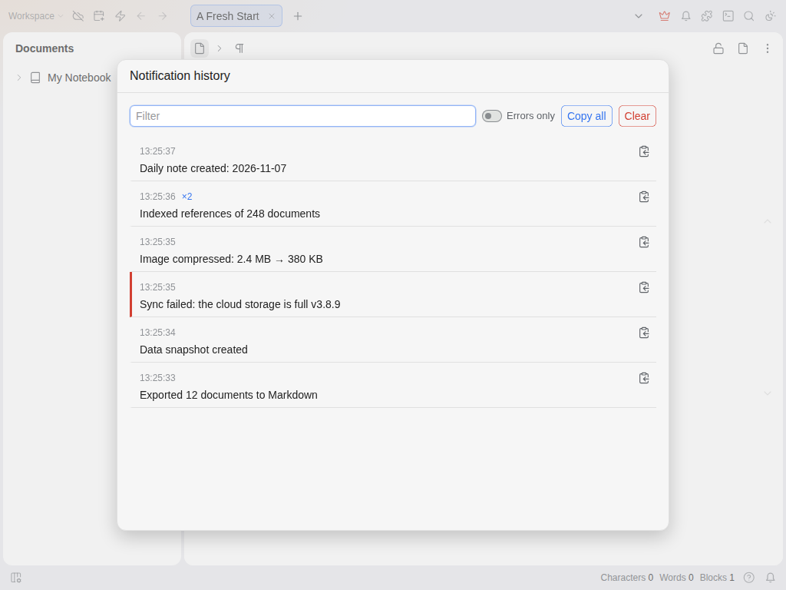

# Notification History

SiYuan's pop-up messages disappear after a few seconds. An export finishes, a sync fails, a plugin reports
something, and if you were looking away it's gone. There is no list of them anywhere.

This plugin keeps them.

Every message that SiYuan or a plugin shows is saved with its time. Open the list with the bell in the top bar,
the bell in the status bar, or the command **Show notification history** (you can give it a shortcut in
Settings → Keymap).

- Newest first. The same message shown again within 10 seconds is counted (`×2`) instead of repeated.
- Error messages get a red mark, and **Errors only** shows just those.
- Messages that change while on screen, like progress or sync status, are saved with their last text.
- Filter box, a copy button on each message, **Copy all** and **Clear**.
- The status bar bell shows how many messages came in since you last looked.

## Settings

- Keep history after restart: on by default. Off keeps the list in memory only.
- Notifications to keep: 50 to 1000, default 200.
- Bell in the status bar: on by default.

The history is stored in the plugin's own data file (`data/storage/petal/notification-history/history.json` in
your workspace). Nothing leaves your device.

## Limits

It records messages from the moment it loads, so the very first ones at startup are missed. It reads them from
the screen, so the text is saved but buttons and links inside a message are not. Tested on SiYuan 3.8.9 (Linux,
browser front end); not yet on mobile.

## Licence

MIT. Source: <https://github.com/prometheus-maker/siyuan-notification-history>. Problems and ideas: open an issue
there.
