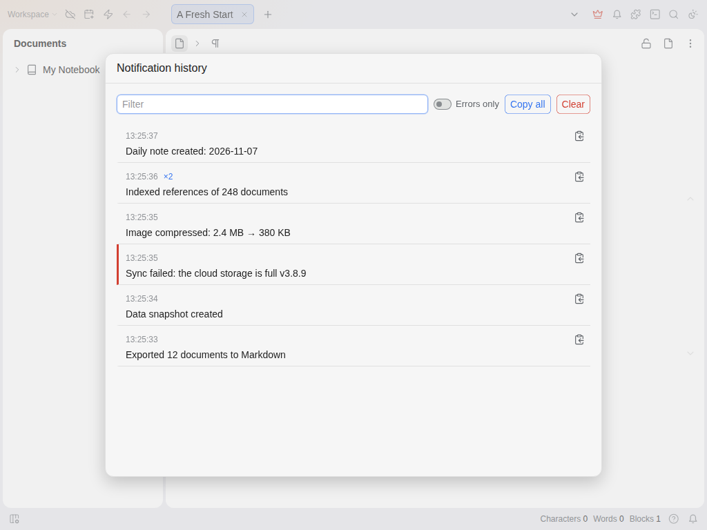

# 通知历史

思源的弹出消息几秒后就会消失。导出完成、同步失败、插件给出提示，如果当时没看屏幕，消息就没了，而且没有地方可以再查看。

这个插件会把它们保存下来。

思源或插件显示的每条消息都会连同时间一起保存。点击顶栏的铃铛、状态栏的铃铛，或执行命令 **显示通知历史**（可在 设置 → 快捷键 中为它设置快捷键）即可打开列表。

- 最新的在最上面。同一条消息在 10 秒内再次出现时只计数（`×2`），不重复显示。
- 错误消息带红色标记，勾选 **仅错误** 只看错误。
- 显示期间内容会变化的消息（如进度、同步状态）保存最后的文字。
- 支持筛选、单条复制、**全部复制** 和 **清空**。
- 状态栏铃铛显示自上次查看以来收到的消息数量。

## 设置

- **重启后保留历史**：默认开启。关闭后只保存在内存中。
- **保留的通知数量**：50 到 1000，默认 200。
- **状态栏铃铛**：默认开启。

历史保存在插件自己的数据文件中（工作空间内 `data/storage/petal/notification-history/history.json`），不会离开你的设备。

## 限制

插件加载之后才开始记录，所以启动时最早的几条消息不会被保存。它从屏幕上读取消息，只保存文字，不保存消息里的按钮和链接。已在思源 3.8.9（Linux，浏览器端）上测试，尚未在移动端测试。

## 许可证

MIT。源码：<https://github.com/prometheus-maker/siyuan-notification-history>。问题和建议请在那里提 issue。
